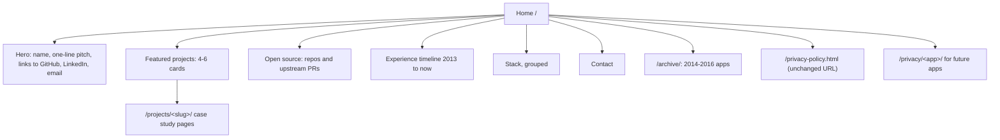
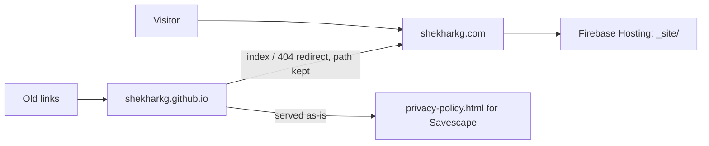

# Portfolio Refresh Plan: shekharkg.github.io

_Written 2026-11-25 · Branch: `portfolio-refresh`_

## 1. Where things stand

### The current site (last real change: Oct 2021, content from 2014–2016)

| Area | State | Problem |
|---|---|---|
| Template | Start Bootstrap "Freelancer" (Bootstrap 3, jQuery, Font Awesome 4) | Looks dated, ships ~400 KB of JS and CSS the page doesn't need |
| Headline | "Android App Developer" | Undersells the current stack: Kotlin/Compose, React/TS, React Native/Expo, Godot, Firebase, AI |
| Portfolio | 6 apps from 2014–2016 (Sword of God's Word, Price Tag, Shining Floor, Expense Manager, Moon PDF, SMS Exporter) | Nothing from the last 9 years. The Price Tag Play link returns 404 and the APK is hosted on Dropbox |
| About / Contact | Hidden with `display:none`, "WORK IN PROGRESS" | `mail/contact_me.php` can't run on GitHub Pages |
| Footer | Email `mail@shekharkg.com`, **personal mobile number**, Facebook, Google+, Twitter | `shekharkg.com` doesn't resolve, so the email may bounce. Google+ is shut down. The phone number is publicly scraped |
| Fonts | Loaded over `http://` | Mixed-content warnings |
| `privacy-policy.html` | Savescape privacy policy | **Must keep this URL working.** A Play listing probably links to it |
| README | The template author's README | Says nothing about you |

### What you've built since (from `~/workspace` and GitHub)

| Project | What it is | Stack | Activity | Public? | Live link |
|---|---|---|---|---|---|
| **ShellPhone** | Typing-first, privacy-first Android launcher | Kotlin, Compose, multi-module (`core-*`, `data-*`, `feature-*`), baseline-profile benchmark | 71 commits, Mar–Nov 2026 | Private | shellphone.web.app (200). Play listing not live yet (404) |
| **ShellPhone web** | No-JS, no-tracking bilingual (EN/HI) marketing site with a build check that blocks third-party requests | Eleventy, Firebase Hosting | Nov 2026 | Private | shellphone.web.app |
| **Tickover** | Offline-first vehicle fuel and expense log with importers for six other apps | Expo SDK 58, RN, TS, pnpm and Turborepo monorepo, Drizzle/SQLite, Firestore sync, enforced package boundaries | 100 commits in 2 weeks | Private | In development (launch target May 2027) |
| Tank & Tolls / vehicle-hub | Earlier versions of Tickover | React Native, React web, Firebase, GitHub Actions CI | 2025–Jan 2026 | Private | – |
| **School Manager** | Multi-tenant SaaS for Indian schools: GST billing, Razorpay, MSG91 DLT SMS, CBSE grading | React (Vite), Firebase Auth/Firestore/Functions | 295 commits, the largest codebase | Private | – |
| **Rush Hour Rescue** | Sliding-block traffic puzzle: level map, daily challenges, coin economy, hints and undo | Godot 4.6, GDScript, Android export, test runner | 27 commits | Private | Screenshots in `docs/rd_*.png` |
| **Amaze Direction** | Minimalist 3D arrow-block puzzle with 100 hand-made levels, all checked as solvable by a validator | Godot 4.6, 74 logic tests, 28 runtime checks, benchmark | 15 commits | Private | Screenshots in `capture/` |
| **Ghumlo** | Client marketing site for a Patna travel agency | React 19, TS, Tailwind v4, React Router 7, Firebase, sitemap generation | Oct 2026 | Private | ghumlo.co.in (200) |
| Ode Home | E-commerce site for a family candle business: Google, email and OTP auth, orders, addresses | React, TS, Firebase | Dec 2025 | Private | – |
| Quill Byte | Studio/brand website (`com.quillbyte.*` is your app namespace) | React, Vite, Firebase | 2025–26 | Private | – |
| IronFuel | Workout planner | Expo 54, RN, Zustand, expo-sqlite, Jest, e2e | 33 commits | Private | – |
| Wear OS faces (ClauseWatchFace, watch, QuillOrbit) | Skeuomorphic, gyroscope-parallax and dashboard watch faces | Kotlin, Watch Face Format | 2025–26 | Local only | – |
| Cosmic Launcher | Space-themed home and lock-screen launcher with a PIN lock | Kotlin, Compose | 2026 | Local only | – |
| AI work | AI4ICPS training capstone (scoring, ranking, evaluation pipeline), textToSql with a local LLM (Ollama), DocuByte-AI, agentic experiments | Python, Kotlin | 2024–Nov 2026 | Private/local | – |
| KotlinPlayground | DSA practice and Kotlin Koans | Kotlin | **449 commits since 2019** | Private | – |
| 2013–2022 public repos | ~40 Android samples: OMDB MVVM, GitHub-PR, Wiki-Search, Export-SMS, Price-Tag, LibGDX demo… | Java/Kotlin | Dormant | Public | – |

### Open source, honestly

- **External contributions on GitHub:** one PR (a hiring assignment, 2024) and one issue (CountryCodePicker, 2018).
- **Public repos with recent work:** none. Everything since 2022 is private.
- **Forks:** iosched, sceneform, android-hilt, android-interview-questions. Forks with no commits of yours don't count as contributions.

**So the biggest gap isn't the website, it's that there's no public evidence.** A recruiter who clicks through to GitHub today sees work from 2014–2019. The plan below fixes the site, but Phase 0 (deciding what goes public) matters more.

## 2. Goals

1. Position you as **"Software engineer: mobile, web and games. I ship products and contribute to open source."**
2. Show 4–6 flagship projects from 2025–26 with screenshots, stack, your role, and a link: live site, store, or repo.
3. Give open source its own section that grows over time and is fed by real public activity.
4. Keep the site fast, accessible, free to host on GitHub Pages, and easy to update with one data file per project.
5. Don't break existing URLs (`/privacy-policy.html`) and don't expose private details (phone number).

## 3. Information architecture



### Featured projects, ranked

| Rank | Project | Why it leads | Asset available | Link to show |
|---|---|---|---|---|
| 1 | ShellPhone | Original product, modern Android architecture, privacy angle, has a site | App screenshots (capture), site | shellphone.web.app (+ Play once live) |
| 2 | Tickover | Strongest engineering story: monorepo, offline-first sync, importers, enforced boundaries, golden tests | `design/` preview | Repo if opened, otherwise case study |
| 3 | School Manager | Real multi-tenant SaaS with payments and SMS compliance, 295 commits | Needs screenshots with demo data | Case study (no client data) |
| 4 | Rush Hour Rescue + Amaze Direction | Shows range. Godot with tested level validators and benchmarks | `docs/rd_*.png`, `capture/*.png` | Store or itch.io once published |
| 5 | Ghumlo | Shipped client work, live | Live site screenshots | ghumlo.co.in |
| 6 | Wear OS faces / AI work | "Labs" strip of smaller cards | Screenshots | Repo links if public |

Under that, a "More work" grid (Ode Home, Quill Byte, IronFuel, Cosmic Launcher) and an **Archive** page that moves the six 2014–2016 apps out of the main grid while keeping them visible.

## 4. Open-source track (Phase 0, runs alongside the site work)

The site can only show what's public, so build public evidence first.

**A. Open-source or extract parts of your own work** (pick 2–3):

| Candidate | What to publish | Effort | Signal |
|---|---|---|---|
| `@tickover/importers` | Pure adapters that parse Drivvo, Fuelio and other exports, plus a CSV mapper and the golden tests | Low. Already pure and tested | High. Useful to other devs, a real library |
| `@tickover/domain` | km/L, cost and forecast maths | Low | Medium |
| ShellPhone command parser / launcher core | If the app stays closed, extract the prompt engine as a library | Medium | High. Unusual and interesting |
| Godot level validator / solver (Amaze Direction) | BFS solvability checker as a Godot addon | Low–medium | Medium. Godot community is active |
| shellphone-web "no third-party" check | Eleventy plugin that fails the build on external requests and scripts | Low | Medium. Small but neat |
| Rush Hour Rescue or Amaze Direction full source | Only if you don't plan to monetize it | – | High |

Each one needs a README with a screenshot, a LICENSE (MIT or Apache-2.0), CI (GitHub Actions running tests), topics, and a `homepage` field pointing to its portfolio page.

**B. Contribute upstream to tools you already use.** Aim for a steady pace, such as 1–2 PRs a month, not a one-off burst:

| Project | Why you're credible there |
|---|---|
| Godot (engine and docs), Godot addons | Two shipped Godot 4.6 games, Android export experience |
| Expo / React Native libraries (expo-sqlite, Drizzle) | Tickover and IronFuel |
| Eleventy and its plugins | shellphone-web |
| Android: Compose samples, AndroidX issues, Watch Face Format samples | 10+ years of Android |

Start with docs fixes, bug reproductions, and "good first issue" labels. Log every merged PR in `src/_data/oss.json`, or let the build fetch it (see §5).

**C. Tidy GitHub itself:**
- Create the `shekharkg/shekharkg` profile README: pitch, featured repos, link to the portfolio.
- Pin 6 repos: the newly public ones first, then the best of the older samples (OMDB-MVVM, GitHub-PR).
- Archive (don't delete) the dead 2013–2017 repos, or leave them with a short description. Delete or make private the unused forks.
- Set the profile name, bio, blog URL (`https://shekharkg.github.io`) and an email that works.

## 5. Technical approach

> **Updated 2026-11-25:** hosting moved to Firebase Hosting on `shekharkg.com` (see §8). The open-source data is refreshed by `npm run oss` before a deploy rather than fetched during the build, so builds never depend on the network. Where this section says GitHub Pages, read Firebase Hosting.

**Recommendation: rebuild with Eleventy and deploy through GitHub Actions to GitHub Pages.**

- You already know Eleventy from shellphone-web, and its "no JS, no trackers" approach suits a portfolio well.
- Projects become data (`src/_data/projects.json`, or one Markdown file per project with front matter), so adding a project means adding one file.
- Plain CSS with custom properties, light and dark themes, system font stack or one self-hosted variable font. No Bootstrap, no jQuery.
- **Build-time GitHub data:** a small `_data/github.js` calls the GitHub API during CI to pull public repo stars and merged upstream PRs (`is:pr author:shekharkg is:merged -user:shekharkg`). The OSS section then updates on every deploy or on a weekly scheduled rebuild. If the API fails, the build falls back to a cached JSON file so it never breaks.
- Images: WebP/AVIF through `@11ty/eleventy-img`, with `width` and `height` set and lazy loading.
- SEO: per-page title and description, Open Graph image, `sitemap.xml`, `robots.txt`, JSON-LD `Person` schema, canonical URLs.
- Contact: a `mailto:` link plus GitHub and LinkedIn. If you want a form later, Formspree or a Firebase Function. No PHP.
- Quality gates in CI: build, HTML validation, link check (lychee), Lighthouse CI budget (Performance, A11y, SEO ≥ 95), and a port of shellphone-web's no-third-party check.

Alternative if you'd rather have components and islands: Astro. It's the same deploy story with a bit more tooling. Either works, and Eleventy keeps things consistent with what you already maintain.

### Proposed repo layout

```text
shekharkg.github.io/
├── .github/workflows/deploy.yml   # build → test → upload-pages-artifact → deploy-pages (+ weekly cron)
├── eleventy.config.js
├── package.json
├── src/
│   ├── _data/
│   │   ├── site.js                # name, pitch, links, email
│   │   ├── projects/*.md          # one file per project (front matter + case study)
│   │   ├── experience.json
│   │   ├── oss.json               # manual entries + cache for GitHub fetch
│   │   └── github.js              # build-time API fetch with fallback
│   ├── _includes/                 # base layout, project card, header/footer
│   ├── assets/css/site.css
│   ├── assets/img/projects/<slug>/
│   ├── index.njk
│   ├── projects/project.njk       # paginated case-study pages
│   ├── archive.njk                # 2014–2016 apps
│   └── privacy-policy.html        # passthrough copy, URL unchanged
├── scripts/check.js               # no third-party, required pages exist
├── docs/portfolio-refresh-plan.md
└── README.md                      # rewritten: about the site, how to add a project
```

Old template files (`css/`, `less/`, `js/`, `fonts/`, `font-awesome/`, `mail/`) get removed. The legacy screenshots in `img/portfolio/` move to `src/assets/img/archive/`.

## 6. Work plan on branch `portfolio-refresh`

Status as of 2026-11-25. Everything below is local and uncommitted; nothing is pushed or deployed.

| Step | Task | Status |
|---|---|---|
| 0 | Branch `portfolio-refresh` created, plan written | ✅ |
| 1 | Decisions recorded (§8) | ✅ |
| 2 | Eleventy 3 scaffold, base layout, one stylesheet, light/dark via `prefers-color-scheme`, no JS | ✅ |
| 3 | `privacy-policy.html` passthrough at the same path (inline style swapped for a stylesheet so the CSP allows it; text untouched) | ✅ |
| 4 | Hero, skills, contact. No employment timeline | ✅ Copy needs your review |
| 5 | `src/_data/projects.js`: 5 case studies + 6 "more work" cards, client work anonymised, all "by Quill Byte" | ✅ Copy needs your review |
| 6 | Screenshots from ShellPhone store assets, Tickover design preview, both Godot games (resized JPEG, ~800 KB total) | ✅ None for client work |
| 7 | Open-source section: curated public repos + `npm run oss` to pull merged upstream PRs into `oss.json` | ✅ Contributions list hidden until it has entries |
| 8 | `/archive/` page for 2014–2016 apps, dead Play/Dropbox links dropped | ✅ |
| 9 | Canonical URLs, Open Graph tags, JSON-LD `Person`, sitemap, robots, SVG favicon | ✅ OG image still to do |
| 10 | `scripts/check.mjs`: no third-party requests or scripts, no client names, no phone numbers, no broken internal links, required pages exist | ✅ Passes; negative-tested |
| 11 | `firebase.json` with CSP and security headers; CI workflow (build + check); GitHub Pages redirect workflow | ✅ |
| 12 | Old Bootstrap template removed, README rewritten | ✅ |
| 13 | Visual check: desktop, 375 px phone, dark mode | ✅ Done by Claude; your sign-off pending |
| 14 | Firebase project, custom domain DNS, mail for `mail@shekharkg.com` | ⬜ You (see README) |
| 15 | Switch GitHub Pages source to **GitHub Actions**, merge PR, `npm run deploy`, verify `shekharkg.com` and `shekharkg.github.io/privacy-policy.html` | ⬜ You, with go-ahead |

### Hosting after launch



## 7. Content draft (starting point)

- **Headline:** Shekhar Kumar Gupta, software engineer.
- **Pitch:** "I build mobile, web and game products end to end, from Android launchers and offline-first React Native apps to multi-tenant SaaS and Godot puzzle games. I've shipped Android apps since 2013 and I contribute to the open-source tools I use."
- **Skills, grouped:** Android (Kotlin, Compose, Wear OS, multi-module, baseline profiles) · Cross-platform (React Native, Expo, SQLite/Drizzle) · Web (React, TypeScript, Vite, Tailwind, Eleventy) · Backend (Firebase Auth, Firestore, Functions, Security Rules, Razorpay, MSG91) · Games (Godot 4, GDScript) · AI (LLM pipelines, Ollama, evaluation) · Practice (monorepos, CI, testing, AI-assisted development with Claude Code).
- **Each case study:** problem → your role → architecture (a Mermaid diagram is fine) → hard parts → results/status → links.

## 8. Decisions (2026-11-25)

| Question | Decision | Effect on the build |
|---|---|---|
| Private repos going public | None | No repo links on projects; each featured project gets a case study instead. Open source = old public repos + future upstream PRs |
| Client and family work | Anonymised, **except School Manager** (updated 2026-11-25: link to https://skoolio-in.web.app with screenshots) | Travel and e-commerce projects: no names, domains, logos or screenshots; `check.mjs` blocks those names |
| Contact | `mail@shekharkg.com`, no phone | Needs MX records once the domain is revived |
| Employment history | Left out for now | No timeline section |
| Quill Byte | Presented as the studio | Projects read "by Quill Byte" |
| Domain | Revive `shekharkg.com` | Canonical URLs, sitemap and JSON-LD use it |
| Hosting | Firebase Hosting | `firebase.json`; GitHub Pages becomes a redirect |
| Stack | Eleventy (Claude's call) | Same tool and conventions as shellphone-web; zero client JS; Astro adds nothing a static portfolio needs |

### Consequences for the open-source track (§4)

With no private code going public, §4A (extracting libraries) is off the table. The OSS story now rests on §4B and §4C: steady upstream PRs to Godot, Expo/React Native libraries, Eleventy and Android tooling, and a tidy GitHub profile. The hero copy currently says "I … contribute back to the open-source tools I build on"; that line needs real merged PRs behind it, so either start contributing before launch or soften the line.
